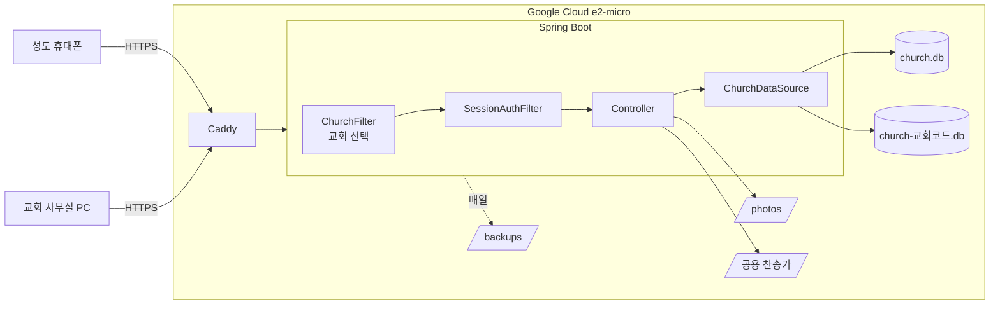

# 교회 관리 시스템

[](https://github.com/swh7j/churchService/actions/workflows/ci.yml)

작은 교회에서 쓰는 회계·교인·주보·예배 PPT 관리 웹 서비스입니다.
2026년 11월부터 실제 교회에서 쓰고 있습니다. 교회 사무는 관리자 화면에서 하고, 성도들은 로그인 없이 휴대폰으로 소식과 주보, 앨범을 봅니다.
서버 하나에서 여러 교회를 따로 운영할 수 있게 만들었습니다.

- 백엔드: Spring Boot 4 (Java 17), Spring Security, JdbcTemplate, SQLite, Apache POI
- 프론트엔드: React 19, Vite
- 운영: Google Cloud e2-micro (무료 범위), Caddy, systemd
- 테스트: 서버 61개(JUnit 5), 화면 25개(Vitest), ESLint, GitHub Actions

## 만든 이유

교회에는 매주 반복되는 수작업이 많았습니다.

- 헌금과 지출은 엑셀과 종이에 따로 적고, 연말이면 예결산서를 손으로 다시 정리했습니다.
- 주보는 매주 한글 파일을 열어 새로 고쳤습니다.
- 예배 PPT 를 만들 때마다 찬송가 PPT 를 찾아서 복사해 붙였습니다.
- 소식이나 사진은 단체 채팅방에 올리면 금방 묻혔습니다.

지금은 헌금을 입력하면 장부와 결산이 자동으로 계산되고, 예결산서는 교회가 쓰던 종이 양식 그대로 엑셀로 나옵니다.
주보는 원래 쓰던 모양 그대로 화면에서 작성해 인쇄하고, 예배 PPT 는 주보에 적은 찬송 번호만으로 악보 화면까지 채워집니다.

처음부터 다 계획한 건 아니고, 교회에서 써 보면서 나온 요청을 하나씩 반영해 왔습니다.
"예결산서가 종이랑 달라요", "주보 뒷면이 거꾸로 인쇄돼요", "경배와 찬양도 넣고 싶어요", "PPT 배경을 바꾸고 싶어요" 같은 것들입니다.

## 기억에 남는 문제들

전체 기록은 [docs/troubleshooting.md](docs/troubleshooting.md) 에 있습니다.

**찬송가 때문에 디스크가 9일 뒤 찰 뻔했습니다.**
처음엔 찬송가를 교회 DB 에 넣었는데, 두 교회가 같은 자료(각 1.2GB)를 따로 갖고 있었고 매일 전체 백업을 30개 보관하다 보니 백업 한 번이 2.5GB 였습니다.
찬송가는 어느 교회나 같으니 서버에 한 벌만 두는 공용 보관함으로 바꿨고, 교회 DB 는 1.2GB 에서 4.9MB 가 됐습니다.

**찬송가 PPT 를 그림으로 바꿨더니 배경이 사라졌습니다.**
배경 사진은 슬라이드 마스터에 있고 악보는 그 위의 투명 PNG 였습니다. POI 로 배경, 마스터 그림, 슬라이드 그림 순서로 직접 합성하게 바꿨습니다.
그 뒤에 645개 중 31개만 또 실패했는데, 파일 안에 남은 빈 그림 칸 때문에 POI 가 그림을 한 칸씩 밀려 읽고 있었습니다.

**로그인 잠금이 오히려 공격 수단이 될 수 있었습니다.**
"아이디별 5회 실패하면 잠금"이면 누구나 관리자 아이디로 일부러 틀려서 관리자를 계속 잠글 수 있습니다. 기준을 아이디+IP 로 바꾸고 IP 전체, 아이디 전체 제한을 따로 뒀습니다.

**"아이폰에서만 PPT 에 찬송가가 반복돼요."**
파일을 PC 에서 열어 보면 정상이었습니다. 아이폰 미리보기가 같은 이름의 예전 파일 화면을 다시 쓰고 있었고, 파일 이름에 만든 시각을 붙여 해결했습니다.

## 주요 기능

관리자 화면(`/c/{교회코드}/admin`)

- 교인 관리, 출석, 생일(음력 포함)
- 헌금 입력, 회계 장부, 소모임 장부, 월별·연간 결산과 예산, 엑셀 내보내기
- 4면 주보 작성·인쇄, 교회 소식, 행사, 악보, 앨범
- 예배 PPT 만들기: 서식 PPT 의 `{영광송}` 같은 자리를 주보 내용으로 채우고, 찬송가·교독문 화면을 자동으로 넣음
- 사용자·권한, 백업과 복원, 활동 기록

성도 화면(`/c/{교회코드}`)에서는 로그인 없이 소식, 주보, 행사, 악보, 앨범을 보고 기도제목이나 요청을 남길 수 있습니다.
전체 관리자 화면(`/platform`)에서는 교회를 등록하고, 모든 교회가 같이 쓰는 찬송가 보관함(찬송가 645장, 교독문 137개 등)을 관리합니다.

### 데모

운영 서버에 실제 교회와 DB 가 분리된 데모 교회(`/c/demo`)를 따로 두었습니다. 교인 40명과 2025년부터의 헌금·장부, 주보, 앨범 같은 가짜 데이터가 들어 있습니다.
데이터는 [`scripts/demo-seed.js`](scripts/demo-seed.js) 로 넣었고, 교회 코드가 `demo` 로 시작하지 않거나 교인이 이미 있으면 멈추게 해서 실제 교회에는 실행되지 않습니다.
시연 계정은 따로 안내합니다.

## 구조



React 빌드 결과를 Spring 이 같이 내보내서 jar 하나로 돌아갑니다. 바깥에는 Caddy 만 열려 있습니다.

여러 교회를 지원하는 방식이 이 프로젝트에서 제일 신경 쓴 부분입니다.
요청이 들어오면 `ChurchFilter` 가 `X-Church` 헤더로 교회를 정해 `ThreadLocal` 에 넣고, `ChurchDataSource` 가 그 교회의 DB 연결을 꺼내 씁니다.
교회가 정해지지 않은 채 DB 에 접근하면 다른 교회로 새지 않고 바로 오류를 내게 했습니다. 실수로 다른 교회 데이터가 보이는 것보다 오류가 낫다고 봤습니다.
이 부분은 `ChurchIsolationTest` 에서 두 번째 교회를 만들어 데이터, 로그인 쿠키, 계정이 섞이지 않는지 확인합니다.

단순한 표(교인, 헌금, 소식 등)는 `Resources.java` 에 칸과 권한만 적으면 `/api/{표이름}` 이 생기는 공통 CRUD 로 처리하고, 결산 같은 집계는 SQL 을 직접 씁니다.

```
api/src/main/java/com/church/api/
  tenant/   교회 선택, 교회 목록, 전체 관리자
  config/   교회별 DataSource, 스키마, 보안 설정
  auth/     로그인, 세션, 사용자
  crud/     공통 CRUD
  finance/  장부, 결산
  church/   주보, 예배 PPT, 찬송가 보관함, 앨범, 성도 화면 등
  backup/   백업·복원
  audit/    활동 기록
src/        React (pages: 관리자, public: 성도, platform: 전체 관리자)
deploy/     서버 설치·배포 스크립트
docs/       트러블슈팅 기록
```

## 기술을 고른 이유와 한계

**SQLite, 교회마다 파일 하나.** 교회 규모가 작고 서버도 한 대라 DB 서버를 따로 띄울 이유가 없었습니다. 교회별로 파일이 나뉘어 있어서 백업과 복원도 파일 하나(`VACUUM INTO`)로 끝납니다.
대신 쓰기는 한 번에 하나씩만 되고, 서버를 여러 대로 늘릴 수 없습니다. 교회 사무실 몇 명이 쓰는 정도라 문제가 되지 않는다고 판단했습니다. 규모가 커지면 다른 DB 로 옮겨야 합니다.

**JPA 대신 JdbcTemplate.** 결산은 월별 합계, 이월 잔액 같은 집계라서 SQL 이 그대로 보이는 게 맞는지 확인하기 편했습니다.
그 대신 표마다 SQL 과 매핑을 손으로 써야 해서, 단순한 표는 `Resources.java` 에 선언만 하면 되는 공통 CRUD 를 따로 만들어 반복을 줄였습니다.

**JWT 대신 DB 세션.** 비밀번호를 바꾸거나 계정을 막으면 그 자리에서 로그인이 끊겨야 했습니다.
요청마다 세션을 DB 에서 한 번 읽는 비용이 생기는데, 만료 시간 연장은 남은 시간이 절반 이하일 때만 해서 쓰기는 거의 생기지 않게 했습니다.

**PPT 와 엑셀은 브라우저에서 생성.** 메모리 1GB 서버에서 큰 파일을 만들고 싶지 않았습니다. 서버는 브라우저가 못 읽는 옛날 `.ppt` 를 그림으로 바꿀 때만 Apache POI 를 씁니다.
그만큼 만드는 속도는 사용하는 PC 나 휴대폰에 따라 달라지고, OOXML 을 직접 다루다 보니 PowerPoint 에서만 보이는 문제를 직접 찾아야 했습니다(예배 PPT 테스트를 따로 둔 이유).

## 보안

한 서버를 여러 교회가 같이 쓰기 때문에 교회끼리 데이터가 섞이지 않게 하는 게 먼저였습니다. 교회가 정해지지 않은 채 DB 를 쓰면 바로 오류가 나고, 세션·사진·백업도 교회별로 나뉩니다(`ChurchIsolationTest`).

성도 화면은 로그인 없이 열리기 때문에, 공개 API 는 `/api/public/**` 조회와 기도제목·요청 글쓰기만 허용하고 공개 표시된 자료만 돌려줍니다. 로그인 없이 받는 요청은 64KB 로 제한합니다.

로그인 잠금은 처음 만든 방식이 오히려 공격에 쓰일 수 있어서 바꿨습니다(위 문제 기록 참고).

그 밖에 비밀번호 scrypt, HttpOnly 세션 쿠키, 역할별 권한(`@PreAuthorize`), CSP, 업로드 사진 메타데이터 제거, 모든 수정의 활동 기록을 적용했습니다.

## 테스트

```bash
cd api && ./mvnw test    # 서버 (Windows: mvnw.cmd test)
npm run check            # 화면: ESLint + Vitest
```

서버 테스트는 대부분 임시 폴더에 실제 서버를 띄우고 HTTP 로 요청하는 통합 테스트입니다. 권한, 교회 간 격리, 결산 계산, 백업 같은 걸 확인합니다.
화면 테스트는 예배 PPT 만들기와 주보 계산처럼 틀리면 결과물이 바로 잘못 나오는 부분을 다룹니다.
푸시할 때마다 GitHub Actions 에서 둘 다 돌아갑니다.

## 실행

Node.js 22.12 이상, Java 17 이상이 필요합니다.

```bash
npm install
npm run dev      # Spring(8080) + React(5173), http://localhost:5173
```

`npm run build` 후 `npm start` 로 서버 하나로도 실행할 수 있습니다(http://localhost:8080).

## 배포

서버 준비는 [deploy/README-google.md](deploy/README-google.md) 에 정리했습니다.
`npm run deploy` 를 실행하면 빌드해서 올리고 서버 설정(Java, Caddy, systemd, HTTPS)까지 합니다. 여러 번 실행해도 데이터와 백업은 건드리지 않습니다.
백업은 하루 한 번 자동으로 하고 최근 30개를 남깁니다. 서버 밖 보관용으로 관리자가 내려받은 지 30일이 지나면 대시보드에 알림이 뜹니다.

실제 교회 데이터와 서버 접속 정보는 저장소에 넣지 않았습니다.
