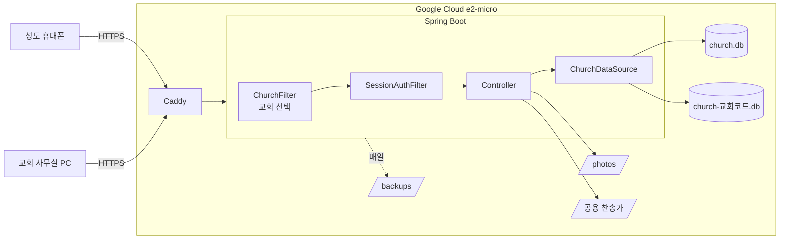

# 교회 관리 시스템

[](https://github.com/swh7j/churchService/actions/workflows/ci.yml)

작은 교회의 회계, 교인, 주보, 예배 PPT를 관리하는 웹 서비스입니다.
2026년 11월부터 실제 교회에서 쓰고 있습니다. 사무는 관리자 화면에서 보고, 성도들은 로그인 없이 휴대폰으로 소식과 주보, 앨범을 봅니다.
서버는 한 대고, 데이터는 교회별로 나뉩니다.

- 백엔드: Spring Boot 4 (Java 17), Spring Security, JdbcTemplate, SQLite, Apache POI
- 프론트엔드: React 19, Vite
- 운영: Google Cloud e2-micro (무료 범위), Caddy, systemd
- 테스트: 서버 69개(JUnit 5), 화면 41개(Vitest), ESLint, GitHub Actions
- 개발 방식: 코드는 Claude Code(AI)와 같이 짰습니다. 무엇을 만들지 정하고, 설계를 고르고, 결과가 맞는지 확인하고, 배포하고 운영하는 건 제가 했습니다.

## 만든 이유

교회 일에는 매주 손으로 되풀이하는 게 많았습니다.

- 헌금과 지출은 엑셀과 종이에 따로 적고, 연말이면 예결산서를 손으로 다시 정리했습니다.
- 주보는 매주 한글 파일을 열어 새로 고쳤습니다.
- 예배 PPT 를 만들 때마다 찬송가 PPT 를 찾아서 복사해 붙였습니다.
- 소식이나 사진은 단체 채팅방에 올리면 금방 묻혔습니다.

지금은 헌금만 입력하면 장부와 결산은 알아서 계산됩니다. 예결산서도 교회가 쓰던 종이 양식 그대로 엑셀로 나옵니다.
주보는 원래 모양 그대로 화면에서 써서 인쇄합니다. 예배 PPT 는 주보에 적은 찬송 번호만 있으면 악보 화면까지 채워집니다.

처음부터 이걸 다 계획한 건 아닙니다. 교회에서 써 보니 요청이 계속 나왔고, 그걸 하나씩 고쳐 왔습니다.
"예결산서가 종이랑 달라요", "주보 뒷면이 거꾸로 인쇄돼요", "경배와 찬양도 넣고 싶어요", "PPT 배경을 바꾸고 싶어요" 같은 얘기들이었습니다.

## 기억에 남는 문제들

전체 기록은 [docs/troubleshooting.md](docs/troubleshooting.md) 에 있습니다.

### "아이폰에서만 PPT 에 찬송가가 반복되고 겹쳐요"

처음엔 만들어진 PPT 파일부터 봤습니다.
PC 의 PowerPoint 로 화면을 한 장씩 그림으로 뽑아 확인했는데, 파일에는 아무 문제가 없었습니다.
그런데 휴대폰 화면에는 그 파일에 들어 있지도 않은 곡이 섞여 나왔습니다.

원인은 파일 이름이었습니다. 같은 주보로 여러 번 만들면 이름이 매번 똑같은데, 아이폰 미리보기가 같은 이름의 예전 파일 화면을 다시 쓰고 있었습니다.
파일 이름에 만든 시각을 붙이니 해결됐습니다.

원인과 상관없는 데를 뒤진 셈인데, 그러다 진짜 문제도 몇 개 찾았습니다.
주보에서 찬송 번호를 못 찾은 칸은 이제 빨갛게 표시하고, 만들기 전에 한 번 더 묻습니다. 교회소식 글상자가 배경 그림과 겹치던 것도 고쳤습니다.

그런데 끝이 아니었습니다. 배경 사진을 바꾼 PPT 는 카카오톡으로 받아 열면 여전히 화면이 겹치거나 순서가 섞였습니다.
같은 파일을 Keynote 로 열면 멀쩡했습니다. 화면 수와 그림을 하나씩 줄인 시험 파일을 만들어 비교해 보니, 아이폰 기본 미리보기가 복잡한 PPT 를 제대로 못 그리는 것이었습니다.
파일 쪽에서 고칠 수 있는 문제가 아니었습니다. 교회에서는 대부분 휴대폰으로 PPT 를 만들고 확인하기 때문에, 그냥 두면 매주 잘못 만든 줄 알고 다시 만들게 됩니다.

그래서 **휴대폰 확인용 PDF** 를 만들었습니다. 서버가 Apache POI 로 화면을 한 장씩 그림으로 그리고, 그 그림을 이어 붙여 PDF 로 돌려줍니다.
메모리 1GB 서버라 한 번에 하나씩만 만들고, 그림은 JPEG 로 줄였습니다. PDF 는 그림만 담으면 돼서 라이브러리 없이 필요한 부분만 직접 썼습니다.
POI 는 한글을 글자마다 끊어도 되는 줄로 봐서 "존재합/니다" 처럼 단어 중간에서 줄을 바꿨습니다. 그리기 전에 띄어쓰기 자리에서 미리 줄을 나눠 두는 걸로 맞췄습니다.

### 그 밖에

**찬송가 때문에 디스크가 9일 뒤 찰 뻔했습니다.**
처음엔 찬송가를 교회 DB 에 넣었습니다. 두 교회가 같은 자료(각 1.2GB)를 각자 갖고 있었고, 매일 전체 백업을 30개씩 남기다 보니 백업 한 번이 2.5GB 였습니다.
생각해 보면 찬송가는 어느 교회나 똑같습니다. 서버에 한 벌만 두는 공용 보관함으로 옮겼더니 교회 DB 가 1.2GB 에서 4.9MB 로 줄었습니다.

**찬송가 PPT 를 그림으로 바꿨더니 배경이 사라졌습니다.**
배경 사진은 슬라이드 마스터에 있고, 악보는 그 위에 얹은 투명 PNG 였습니다. POI 로 배경, 마스터 그림, 슬라이드 그림을 차례로 겹쳐 그리게 바꿨습니다.
그래도 645개 중 31개는 그림을 하나도 못 찾았습니다. PowerPoint 에서는 멀쩡히 열리는 파일들이었습니다. 파일 안에 지워진 빈 그림 칸이 남아 있어서, POI 가 그림을 한 칸씩 밀려 읽고 있었습니다.

**보안 설정이 배경 사진 올리기를 막고 있었습니다.** 아이폰에서 배경 사진을 고르면 "Load failed" 만 떴습니다. 서버에는 요청이 아예 없었습니다.
고른 사진을 `fetch('data:...')` 로 읽고 있었는데, CSP 의 `connect-src 'self'` 가 이것까지 막았던 겁니다. CSP 를 풀지 않고, 사진 글자열을 직접 풀어 읽게 바꿨습니다.

**로그인 잠금이 오히려 공격 수단이 될 수 있었습니다.** 아이디만 기준으로 잠그면 누구나 관리자 아이디로 일부러 틀려서 관리자를 계속 잠가 둘 수 있습니다. 기준을 아이디+IP 로 바꿨습니다.

## 주요 기능

관리자 화면(`/c/{교회코드}/admin`)

- 교인 관리, 출석, 생일(음력 포함)
- 헌금 입력, 회계 장부, 소모임 장부, 월별·연간 결산과 예산, 엑셀 내보내기
- 4면 주보 작성·인쇄, 교회 소식, 행사, 악보, 앨범
- 예배 PPT 만들기: 서식 PPT 의 `{영광송}` 같은 자리를 주보 내용으로 채우고, 찬송가·교독문 화면을 자동으로 넣음. `{표어}`, `{사명선언문}` 은 주보 기본 정보에서 채워서 표어가 바뀌어도 한 군데만 고치면 됨
- 휴대폰 확인용 PDF: 만든 PPT 를 화면별 그림으로 바꾼 PDF. 아이폰 미리보기에서도 PowerPoint 와 같게 보임
- 사용자·권한, 백업과 복원, 활동 기록

성도 화면(`/c/{교회코드}`)에서는 로그인 없이 소식, 주보, 행사, 악보, 앨범을 보고 기도제목이나 요청을 남길 수 있습니다.
전체 관리자 화면(`/platform`)에서는 교회를 등록하고, 모든 교회가 같이 쓰는 찬송가 보관함(찬송가 645장, 교독문 137개 등)을 관리합니다.

### 데모

운영 서버에 데모 교회(`/c/demo`)를 하나 더 만들었습니다. DB 는 실제 교회와 분리돼 있고, 교인 40명과 2025년부터의 헌금·장부, 주보, 앨범 같은 가짜 데이터가 들어 있습니다.
데이터는 [`scripts/demo-seed.js`](scripts/demo-seed.js) 로 넣었습니다. 교회 코드가 `demo` 로 시작하지 않거나 교인이 한 명이라도 있으면 멈추게 해 둬서, 실제 교회에 잘못 돌릴 일은 없습니다.
시연 계정은 따로 안내합니다.

## 구조



React 빌드 결과도 Spring 이 같이 내보내서 jar 하나로 돌아갑니다. 바깥에 열린 건 Caddy 뿐입니다.

제일 신경 쓴 건 여러 교회를 나누는 부분입니다.
요청이 오면 `ChurchFilter` 가 `X-Church` 헤더를 보고 교회를 정해 `ThreadLocal` 에 넣습니다. 그러면 `ChurchDataSource` 가 그 교회 DB 연결을 꺼내 씁니다.
교회가 안 정해진 상태로 DB 를 건드리면 그 자리에서 오류가 납니다. 다른 교회 데이터가 실수로 보이느니 차라리 오류가 나는 편이 낫다고 봤습니다.
`ChurchIsolationTest` 에서는 교회를 하나 더 만들어 놓고 데이터, 로그인 쿠키, 계정이 섞이지 않는지 확인합니다.

교인, 헌금, 소식처럼 넣고 고치고 지우기만 하는 표는 공통 CRUD 로 처리합니다. `Resources.java` 에 칸과 권한만 적으면 `/api/{표이름}` 이 생깁니다. 결산 같은 집계는 SQL 을 직접 씁니다.

```
api/src/main/java/com/church/api/
  tenant/   교회 선택, 교회 목록, 전체 관리자
  config/   교회별 DataSource, 스키마, 보안 설정
  auth/     로그인, 세션, 사용자
  crud/     공통 CRUD
  finance/  장부, 결산
  church/   주보, 예배 PPT, 찬송가 보관함, 앨범, 성도 화면 등
  backup/   백업·복원
  audit/    활동 기록
src/        React (pages: 관리자, public: 성도, platform: 전체 관리자)
deploy/     서버 설치·배포 스크립트
docs/       트러블슈팅 기록
```

## 기술을 고른 이유와 한계

### SQLite, 교회마다 파일 하나

교회 규모가 작고 서버도 한 대뿐이라 DB 서버를 따로 띄울 이유가 없었습니다.
교회마다 DB 파일을 하나씩 주니 앞에 쓴 교회 분리도 쉬워졌습니다. 어떤 교회 요청인지만 정하면 그 교회 파일을 열면 되니까요.
백업과 복원도 파일 하나(`VACUUM INTO`)를 다루는 일이 됩니다.

다만 파일 하나로 백업하는 구조라 DB 에 큰 걸 넣으면 바로 티가 납니다. 매일 30개씩 남기니 들어간 용량이 그대로 30배가 됩니다.
사진은 DB 밖에 파일로 두고 새로 올라온 것만 백업합니다. 찬송가는 DB 에 넣었다가 위에 쓴 것처럼 디스크가 찰 뻔했습니다.

한계도 분명합니다. 쓰기는 한 번에 하나씩만 되고, 서버를 여러 대로 늘릴 수 없습니다.
교회 사무실 몇 명이 쓰는 지금은 문제가 없지만, 사용자가 훨씬 많아지면 다른 DB 로 옮겨야 합니다.

### 나머지

**JPA 대신 JdbcTemplate.** 결산은 집계가 대부분이라, SQL 이 눈에 보여야 숫자가 맞는지 따져 보기 편했습니다.

**JWT 대신 DB 세션.** 비밀번호를 바꾸거나 계정을 막으면 바로 로그인이 끊겨야 했습니다. 요청마다 세션을 DB 에서 읽는 건 감수했습니다.

**PPT 와 엑셀은 브라우저에서 생성.** 메모리 1GB 서버에서 큰 파일을 만들기 싫었습니다. 대신 PowerPoint 에서만 보이는 문제는 OOXML 을 뒤져 가며 직접 찾아야 했고, 예배 PPT 테스트가 있는 이유입니다.
휴대폰 확인용 PDF 만은 브라우저에서 PPT 를 그릴 방법이 마땅치 않아 서버에서 만듭니다. 대신 한 번에 하나씩만 만들게 막아 뒀습니다.

## 보안

서버 한 대를 여러 교회가 같이 쓰니까 교회끼리 데이터가 섞이지 않는 게 제일 먼저였습니다. 교회가 안 정해진 채 DB 를 쓰면 바로 오류가 나고, 세션과 사진, 백업도 교회별로 나눠 둡니다(`ChurchIsolationTest`).

성도 화면은 로그인 없이 열립니다. 공개 API 는 `/api/public/**` 조회와 기도제목·요청 글쓰기만 열어 두고, 공개로 표시한 자료만 내보냅니다. 로그인 없이 들어오는 요청은 64KB 까지만 받습니다.

로그인 잠금은 아이디+IP 를 기준으로 하고, 한 IP 가 여러 아이디를 시도하거나 여러 IP 가 한 아이디를 노리는 경우는 별도로 제한합니다. 처음엔 아이디만 봤다가 바꾼 것인데, 이유는 위 문제 기록에 있습니다.

이 밖에는 이런 것들을 넣었습니다.

- 비밀번호 scrypt 저장
- HttpOnly 세션 쿠키
- 역할별 권한(`@PreAuthorize`)
- CSP
- 올린 사진의 메타데이터 제거
- 올린 파일은 확장자가 아니라 내용으로 검사 (사진은 실제로 열리는 JPEG·PNG 인지, PPT 는 zip 구조와 안쪽 경로까지)
- `npm audit` 과 서버 라이브러리 버전 점검
- 모든 수정에 활동 기록 남기기

## 테스트

```bash
cd api && ./mvnw test    # 서버 (Windows: mvnw.cmd test)
npm run check            # 화면: ESLint + Vitest
```

서버 테스트는 대부분 통합 테스트입니다. 임시 폴더에 서버를 실제로 띄우고 HTTP 로 요청을 보내서 권한, 교회 간 격리, 결산 계산, 백업 같은 걸 봅니다.
화면 테스트는 예배 PPT 만들기나 주보 계산처럼, 틀리면 결과물이 바로 잘못 나오는 부분 위주입니다.
푸시하면 GitHub Actions 에서 둘 다 돌아갑니다.

## 실행

Node.js 22.12 이상, Java 17 이상이 필요합니다.

```bash
npm install
npm run dev      # Spring(8080) + React(5173), http://localhost:5173
```

`npm run build` 후 `npm start` 로 서버 하나로도 실행할 수 있습니다(http://localhost:8080).

## 배포

서버 준비는 [deploy/README-google.md](deploy/README-google.md) 에 정리했습니다.
`npm run deploy` 하나로 빌드, 업로드, 서버 설정(Java, Caddy, systemd, HTTPS)까지 끝납니다. 몇 번을 다시 돌려도 데이터와 백업은 그대로입니다.
백업은 하루 한 번 자동으로 하고 최근 30개를 남깁니다. 서버 밖에도 한 벌 있어야 해서, 관리자가 백업을 내려받은 지 30일이 넘으면 대시보드에 알림이 뜹니다.

실제 교회 데이터와 서버 접속 정보는 저장소에 넣지 않았습니다.
