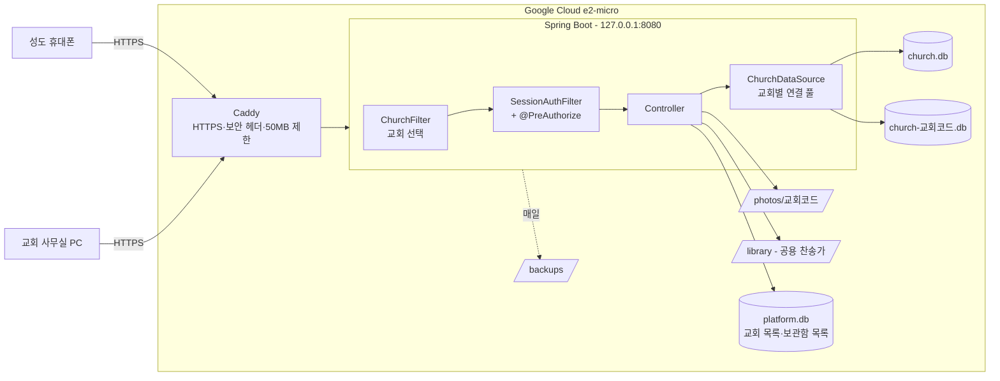

# 교회 관리 시스템

[](https://github.com/swh7j/churchService/actions/workflows/ci.yml)

작은 교회의 **회계·교인·주보·예배 자료**를 한곳에서 관리하는 웹 서비스입니다.
2026년 11월부터 **실제 교회에서 운영 중**이며, 성도는 로그인 없이 휴대폰으로 소식·주보·앨범을 보고,
교회 사무는 관리자 화면에서 처리합니다. 한 서버에서 **여러 교회**를 따로 운영할 수 있습니다.

| | |
|---|---|
| 백엔드 | **Spring Boot 4 (Java 17)**, Spring Security, JdbcTemplate, SQLite, Apache POI |
| 프론트엔드 | **React 19**, Vite, React Router |
| 운영 | Google Cloud e2-micro (항상 무료 범위), Caddy(HTTPS 자동), systemd, 배포 스크립트 |
| 품질 | 서버 테스트 61개 (JUnit 5, 실제 서버를 띄우는 통합 테스트, 교회 간 격리 테스트), 화면 테스트 23개 (Vitest), ESLint, GitHub Actions CI |

---

## 왜 만들었나 — 해결한 문제

| 이전 (수작업) | 지금 |
|---|---|
| 헌금·지출을 엑셀과 종이로 따로 관리, 연말에 예결산서를 손으로 다시 정리 | 헌금 입력 → 회계 장부·월별/연간 결산 자동 계산, **종이 예결산서 양식 그대로 엑셀 한 장**으로 내보내기 |
| 매주 주보를 한글/워드로 새로 편집 | 교회가 쓰던 **주보 양식 그대로** 4면 주보(A4 가로) 작성·인쇄, 권·주 자동 계산, 다음 주로 복사 |
| 예배 PPT를 만들 때마다 찬송가 PPT를 찾아 복사·붙여넣기 | 공용 찬송가 보관함(찬송가 645·교독문 137·경배와 찬양 338)에서 주보의 **장 번호·찬양 제목만으로 예배 PPT에 자동 삽입** |
| 소식·사진을 단체 채팅방에 올려 흘러감 | 성도용 모바일 화면(소식·주보·행사·악보·교회 앨범·익명 기도제목·요청·제보) |

사용자(교회)의 피드백을 받아 바로 고치는 방식으로 기능을 늘렸습니다.
예) "예결산서가 종이랑 달라요" → 소계 묶음·예산 입력·엑셀 한 장 / "주보 뒷면이 거꾸로 인쇄돼요" → 안쪽면 뒤집어 인쇄 옵션 /
"경배와 찬양도 넣고 싶어요" → 곡 제목으로 찾는 공용 보관함 / "악보 요청을 할 곳이 없어요" → 요청·제보 게시판 /
"요즘 주보 모양으로 바꿔 주세요" → 붓글씨 제목·점선 순서의 새 주보 양식 / "PPT 배경을 바꾸고 싶어요" → 관리자 화면에서 배경 그림 올리기

## 주요 기능

**관리자 화면** (`/c/{교회코드}/admin`, 로그인)

| 영역 | 기능 |
|---|---|
| 교인 | 교인 등록·검색, 출석 체크, 생일(음력 지원, 성도 화면 공개 동의) |
| 재정 | 헌금 빠른 입력(교인 자동 매칭), 회계 장부(이월·잔액 자동), 소모임 별도 장부 |
| 결산 | 월별 결산(누계·예산 대비 집행률), 연간 결산(예결산서 양식, 소계 묶음, 다음 해 예산·비고), 엑셀(.xlsx) 한 장, A4 한 장 인쇄 |
| 소통 | 교회 소식, 4면 주보(교회 실제 주보 양식, 붓글씨 제목·교단 로고·표지 사진), 행사 일정, 악보(여러 장 합치기), 교회 앨범(사진 여러 장 업로드), 기도제목 관리, 요청·제보 답변 |
| 예배 PPT | 서식 PPT의 `{영광송}` 같은 자리를 주보 내용으로 채워 .pptx 생성, 찬송가·교독문(번호)·경배와 찬양(곡 제목) 화면 자동 삽입, 교회소식이 길면 화면을 늘려 나눔, 주보에서 못 찾은 칸 표시, **배경 그림 바꾸기**, **공용 찬송가 보관함** 보기·미리보기 |
| 관리 | 사용자·역할, 백업·복원(내려받은 지 30일이 지나면 대시보드 알림), 활동 기록(모든 등록·수정·삭제) |

**성도 화면** (`/c/{교회코드}`, 로그인 없음, 모바일 맞춤) — 소식, 주보(인쇄 가능), 행사, 악보, 교회 앨범, 익명 기도제목, 요청·제보(악보 요청·오류 제보, 관리자 답변)

**전체 관리자** (`/platform`) — 교회 등록, 공통 예배 PPT 양식, **공용 찬송가 보관함**(올리기·지우기, .ppt 수백 개 한 번에), 모든 교회의 요청·제보 답변

### 데모

운영 서버에 실제 교회와 **분리된 데모 교회**(`/c/demo`, DB 파일이 따로)가 있습니다. 교인 40명, 2025년~ 헌금·장부, 예산, 4면 주보, 앨범 등
**가짜 데이터**가 들어 있어 관리자 기능을 그대로 볼 수 있습니다. 주소와 시연 계정은 따로 안내합니다.

- 데모 데이터는 [`scripts/demo-seed.js`](scripts/demo-seed.js) 로 만듭니다 (데모 교회 관리자 화면의 브라우저 콘솔에서 실행).
  교회 코드가 `demo` 로 시작하지 않거나 교인이 이미 있으면 실행되지 않아 실제 교회 데이터를 건드릴 수 없고,
  같은 난수 씨앗을 써서 언제 만들어도 같은 결과가 나옵니다.

## 구조



- **화면 + API 한 서버**: React 빌드 결과를 Spring 이 같이 제공(jar 하나), 바깥에는 Caddy 만 열림 (22·80·443)
- **여러 교회**: 요청마다 `X-Church` 헤더로 교회를 정하고(`ChurchFilter` → `ThreadLocal`), `ChurchDataSource` 가 그 교회 DB 의 연결 풀을 씀. 로그인 세션·백업·사진도 교회별로 분리. 교회 값은 요청이 끝나면 `finally` 에서 지우고, 교회 없이 DB 를 쓰면 다른 교회로 새지 않고 바로 오류 (`ChurchIsolationTest`)
- **공통 CRUD**: `Resources.java` 에 테이블별 칸·권한·검색·정렬을 선언하면 `/api/{테이블}` 이 생김. 집계(결산·장부)는 SQL 로 직접

```
api/src/main/java/com/church/api/
  tenant/    여러 교회: 교회 선택 필터, 교회 목록(platform.db), 전체 관리자
  config/    교회별 DataSource, 스키마·마이그레이션, Security(CSP), 요청 크기 제한
  auth/      로그인·DB 세션·scrypt·로그인 잠금·사용자/역할
  crud/      공통 CRUD (Resources 선언)
  finance/   회계 장부, 결산·예산
  church/    주보·예배 PPT·공용 찬송가 보관함(.ppt 변환)·악보·앨범·기도제목·요청·제보·생일(음력)·성도 화면 API
  backup/    백업·복원·자동 백업, 활동 기록
src/         React — pages/(관리자), public/(성도), platform/(전체 관리자)
deploy/      서버 설치(setup.sh)·배포(deploy.ps1)
```

## 기술 선택과 이유

| 선택 | 이유 |
|---|---|
| **SQLite** (교회마다 DB 파일 하나) | 작은 교회·서버 1대·사용자 수 명 → 별도 DB 서버가 필요 없음(비용 0). 교회별 파일이라 데이터가 섞일 일이 없고, 백업·복원이 파일 단위로 간단(`VACUUM INTO`, 온라인 백업 API). WAL·busy_timeout 으로 동시 접근 처리 |
| **JdbcTemplate** (JPA 대신) | 기능 대부분이 단순 CRUD + 집계 SQL(월별 합계·이월 잔액). 공통 CRUD 선언 + 직접 SQL 이 더 짧고 SQL 이 그대로 보여 튜닝·검증이 쉬움 |
| **DB 세션 + 직접 만든 필터** (JWT 대신) | 로그아웃·비밀번호 변경 시 즉시 끊을 수 있어야 함. httpOnly·SameSite=Lax 쿠키, 토큰은 SHA-256 해시만 저장, 12시간 미사용 시 만료 |
| **사진은 DB 밖 파일** | DB 에 넣으면 매일 백업(30개 보관)이 사진 용량 × 30 으로 커짐 → 파일로 두고 새 사진만 따로 복사 |
| **공용 찬송가 보관함** (교회별 저장 대신) | 찬송가는 모든 교회가 같은 자료 → 서버에 한 벌만(DB 밖 파일 + platform.db 목록). 교회가 늘어도 용량 그대로, 올리기는 전체 관리자만 |
| **PPT·엑셀을 브라우저에서 생성** (jszip 으로 OOXML 직접 작성) | 작은 서버(메모리 1GB)에 부담을 주지 않음. 서버에서는 브라우저가 못 읽는 옛날 `.ppt` 만 Apache POI 로 변환 |
| **Caddy** | 인증서 발급·갱신 자동(HTTPS), 설정이 짧음 |
| **주보 글꼴은 우리 서버에서** (`@fontsource`, 주보를 열 때만 불러옴) | CSP 가 외부 글꼴을 막음(`font-src 'self'`). 한글 글꼴은 크지만 글자 범위별로 나뉘어 쓰는 글자만 받음, 다른 화면은 글꼴 CSS(약 250KB)를 받지 않음 |

## 보안

- 비밀번호 **scrypt** 해시, 세션 토큰은 해시만 저장, 쿠키 `HttpOnly`·`SameSite=Lax`·HTTPS 에서 `Secure`
- 역할별 권한(관리자 / 재정 / 교역자) `@PreAuthorize`, 성도 화면은 `/api/public/**` 조회만 허용하고 공개 표시된 자료만
- **로그인 잠금**: 아이디+IP 5회/5분, IP 전체 20회/15분, 아이디 전체 30회/15분 — 남이 일부러 틀려서 관리자를 잠그지 못하게
- **요청 크기 제한**: 로그인 없는 기능 64KB, 그 외 50MB (앱 필터 + Caddy) — 큰 요청으로 작은 서버 메모리를 바닥내는 공격 방지
- **CSP**(우리 서버 스크립트만), `X-Frame-Options: DENY`, HSTS, `nosniff`
- 업로드 검증(JPEG 시그니처·크기·장 수), 파일 이름은 무작위 + 정규식 검사(경로 조작 방지), 사진은 브라우저에서 다시 그려 GPS 등 메타데이터 제거
- 서버: SSH 키 로그인만, 프로그램은 127.0.0.1 에만 열림, 자동 보안 업데이트, DB·백업 폴더는 서비스 계정만 읽기(700/600)
- 모든 등록·수정·삭제는 활동 기록(audit log)에 남음

## 트러블슈팅 기록

**1. 찬송가 `.ppt` 를 그림으로 바꾸니 노을 배경이 빠짐**
- 원인: 찬송가 PPT 는 배경 사진이 **슬라이드 마스터 배경**이고, 악보·가사는 그 위에 얹은 **투명 PNG** 였음. 슬라이드에서 가장 큰 그림만 꺼내는 방식이라 배경이 없었음
- 해결: Apache POI(HSLF)로 슬라이드마다 *배경 채우기 → 마스터의 그림 → 슬라이드의 그림(묶음 도형은 좌표 변환)* 순서로 한 장에 합성. 서버에 글꼴이 없어도 되게 글자는 그리지 않음
- 재발 방지: 빨간 배경 + 가운데 파란 투명 그림인 `.ppt` 를 테스트에서 직접 만들어 구석·가운데 색을 검사 (`PptImagesTest`)

**2. 앨범 목록 쿼리가 `no such column: a.cover_id`**
- 원인: 대표 사진을 고르려고 스칼라 서브쿼리의 `ORDER BY` 에서 바깥 테이블 칸을 참조 → SQLite 에서 해석 실패
- 해결: `LEFT JOIN album_photos c ON c.id = COALESCE((지정한 대표), (첫 사진))` 구조로 변경, 실제 DB 로 쿼리를 먼저 검증한 뒤 반영

**3. 결산보고서가 A4 3장으로 인쇄됨**
- 원인: 화면에서는 수입|지출 표가 나란히지만, A4 폭에서는 위아래로 쌓여 100줄 가까이 됨
- 해결: 결산 화면이 열려 있는 동안만 `@page`(A4·여백 8mm)와 인쇄용 촘촘한 서식을 적용, 인쇄 때도 좌우 배치. 인쇄 CSS 를 화면에 흉내 내어 높이를 재서 확인(281mm 중 217mm·242mm)

**4. 로그인 잠금이 오히려 공격 수단이 될 수 있음**
- 원인: "아이디별 5회 실패 → 잠금" 이라 누구나 관리자 아이디로 일부러 틀려 관리자를 계속 잠글 수 있음
- 해결: 잠금 기준을 **아이디+IP** 로 바꾸고, 한 IP 에서 여러 아이디를 도는 경우(IP 전체)와 여러 IP 에서 한 아이디를 노리는 경우(아이디 전체)를 따로 제한 (`LoginGuardTest`)

**5. 메모리 1GB 서버에서 큰 파일 다루기**
- 앨범 전체 내려받기(최대 300장)를 메모리에 zip 으로 모으면 힙(384MB)을 넘을 수 있음 → 응답 스트림에 바로 써서 보냄
- 사진은 업로드 전에 브라우저에서 긴 쪽 1600px 로 줄임(휴대폰 원본 3~5MB → 약 0.3MB), 목록은 작은 사진만 받아 데이터 전송량도 줄임

**6. 매일 백업이 사진 때문에 30배로 커질 문제**
- 사진을 DB(BLOB)에 넣으면 하루 한 번 30개 보관하는 DB 백업이 사진 용량 × 30 이 됨
- 사진은 `data/photos/{교회}` 파일로 두고, 백업 때 **새 사진만** `backups/_photos` 로 복사. 지운 사진의 백업본은 30일 보관 후 정리 → 사진을 올린 뒤에도 DB 백업은 수백 KB 유지

**7. 찬송가 31장만 "그림 없음"으로 실패**
- 원인: 파일 안에 지워진 빈 그림 칸(BSE)이 있어 POI 가 그림을 한 칸씩 밀려 연결 → 그림을 하나도 못 찾음 (파워포인트에서는 정상)
- 해결: 라이브러리가 못 찾으면 그림 고유값(UID)으로 직접 찾아 연결(배경 그림도). 645개 파일을 전부 검사해 영향받는 파일이 31개뿐임을 확인
- 같이 개선: 이름은 `.ppt` 인데 속은 `.pptx` 인 파일은 파일 앞부분으로 형식 판단, 가사가 글자로 된 화면은 빠질 수 있어 올릴 때 "확인 필요" 경고

**8. 교회마다 찬송가를 따로 저장하자 9일 뒤 디스크가 찰 상황**
- 원인: 두 교회가 같은 찬송가(각 1.2GB)를 각자 DB 에 저장 + 매일 DB 전체 백업 30개 보관 → 백업 한 번 2.5GB, 남은 20GB 가 약 9일이면 가득
- 해결: 공용 보관함(DB 밖 파일 한 벌)으로 옮기고 새 파일만 백업. 두 교회 자료를 공용 목록과 하나씩 대조해 빠진 곡이 없음을 확인한 뒤 비우고 `VACUUM`
- 결과: 교회 DB 1.2GB → 4.9MB, 매일 백업 수 MB

**9. "PPT에서 찬송가가 반복되고 겹쳐요" (아이폰에서만)**
- 확인: PC 의 PowerPoint 로 화면을 하나씩 그림으로 뽑아 보니 파일은 정상(같은 그림 중복 없음), 보관함 원본도 정상. 휴대폰 화면에는 그 파일에 없는 곡과 그림이 섞여 있었음
- 원인: 같은 주보로 여러 번 만들면 파일 이름이 매번 같고, 아이폰 미리보기가 같은 이름의 예전 파일 화면을 다시 씀
- 해결: 파일 이름에 만든 시각을 붙임. 같이 찾은 진짜 문제도 고침 — 주보에서 찬송 번호를 못 찾은 칸은 빨갛게 표시하고 만들기 전에 물음, 교회소식 글상자가 배경 그림과 겹치지 않게 폭과 한 화면 글자 수를 줄임

**10. 아이폰에서 가끔 "Load failed" 알림**
- 원인: 서버 로그에 그 시각 오류도 요청 기록도 없음 → 요청이 서버에 닿기 전에 끊김(앱 전환·화면 잠금·와이파이↔데이터 전환). 사파리가 영어 오류를 그대로 보여 줌
- 해결: 조회(GET)는 1초 뒤 한 번 더 시도하고, 그래도 안 되면 한국어 안내. 저장(POST 등)은 두 번 저장될 수 있어 다시 보내지 않음

## 테스트 · CI

```bash
cd api
./mvnw test      # 서버 테스트. Windows: mvnw.cmd test  (Java 17)
cd ..
npm run check    # 화면: ESLint 검사 + Vitest 테스트
```

- **단위 테스트**: 음력 → 양력 변환(명절 날짜·작은달 30일), 로그인 잠금 규칙, scrypt 해시, `.ppt` → 그림 변환(배경 합성)
- **통합 테스트**: 빈 임시 폴더에 **실제 서버를 띄워 HTTP 로 요청** — 로그인·역할별 권한·세션 쿠키 플래그, CSP·요청 크기 제한(413),
  결산(월별 합계·소계 묶음·정렬·예산 검증), 앨범(공개/비공개 404·JPEG 검사·zip·사진 백업·삭제 30일 보관),
  공용 보관함(전체 관리자만 쓰기), 요청·제보(10분 20개 제한·비밀글·답변), 백업 알림, 예배 PPT 배경 그림(그림 파일만·로그인 필요), 활동 기록 페이지 나누기
- **교회 간 격리 테스트**: 두 번째 교회를 만들어 데이터·DB 파일·로그인 쿠키(이름을 바꿔 넣어도)·계정이 섞이지 않는지, 없는/중지된 교회 거절, 교회 값 정리
- **화면 테스트 (Vitest + jsdom)**: 예배 PPT 서식 채우기(자리 표시·글꼴 유지·교회소식이 넘치면 화면 복사해 끼우기·자동 맞춤), 배경 그림 찾기,
  주보 권·주 계산, 저장 값 읽기(깨진 JSON·기본값), 교회 소식 → 주보 소식, 날짜 도우미(달·해 넘김·윤년)
- **ESLint**: 안 쓴 변수, import 안 한 컴포넌트, 목록 key 빠짐, 훅 잘못 쓰기 (모양은 검사하지 않음)
- **GitHub Actions**: 푸시·PR 마다 서버 테스트(`mvnw verify`), 화면 검사·테스트·빌드

## 실행 방법

필요: Node.js 22.12+, Java 17+ (Maven 은 `mvnw` 사용)

```bash
npm install      # 처음 한 번만
npm run dev      # Spring(8080) + React(5173) → http://localhost:5173
```

- `JAVA_HOME` 이 Java 8 이어도 PATH 의 Java 17 을 찾아 씀 (`scripts/run-api.mjs`)
- 서버 하나로 실행: `npm run build` → `npm start` (http://localhost:8080, 화면 + API)
- 환경변수: `PORT`, `DATA_DIR`, `BACKUP_DIR`, `COOKIE_SECURE=1`(HTTPS), `DEFAULT_CHURCH`

## 배포·운영

- 서버 준비: [deploy/README-google.md](deploy/README-google.md) (Google Cloud)
- 배포: `npm run deploy` — 빌드 → 업로드 → `setup.sh`(Java·Caddy 설치, systemd 서비스, 스왑, 권한, HTTPS 설정). 여러 번 실행해도 안전, 데이터·백업은 건드리지 않음
- 백업: 하루 한 번 자동(최근 30개), 관리자 화면에서 수동 백업·다운로드·복원(복원 직전 상태 자동 보관). 서버 밖 보관은 관리자가 내려받기(30일 지나면 알림)
- 비용: Google Cloud 항상 무료 범위(e2-micro, 표준 디스크 30GB, 임시 외부 IP) + 예산 알림
- 실제 교회 데이터(`data/`, `backups/`)와 서버 접속 정보는 저장소에 포함하지 않음
